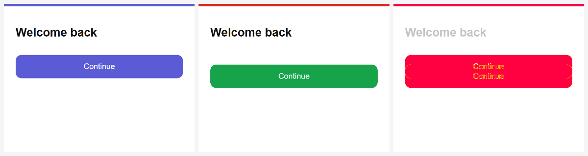

# figma-lens

Let Claude Code (or any coding agent) **see Figma designs accurately**, **check its own result against them**, and **reuse your real widgets**, without the Figma MCP, the REST API or Dev Mode.

1. **Export:** a Figma plugin reads the frame you select. A local bridge writes everything an agent needs to implement it in Flutter or on the web for any technology.
2. **Compare-and-fix loop:** `figma-lens check` renders what the agent built, compares it with the Figma frame, and names the Figma layers that differ, so the agent can fix them and re-check.
3. **Component map:** `figma-lens.map.json` ties Figma components and tokens to your real code (`Button → lib/widgets/app_button.dart#AppButton`), so the agent reuses them instead of rebuilding them.



*Output of `figma-lens demo` on a small test page (not a real Figma file). First frame: the first build (red bar) has the button 20px too low and the wrong color, so the diff marks it. Second frame: the fixed build (green bar), 0% different.*

```
design/<frame>/
  spec.md            compact layer tree: auto layout, sizes, colors, text, radii, shadows, components, variables
  spec.json          full data, including Figma's generated CSS per layer
  tokens.json        variables (every mode), styles, and usage counts of raw values
  screen@2x.png      full render
  sections/*.png     the page's blocks, cropped (long edge ≤ 1568 px; one huge block is split into its children)
  sections/*.md      large frames only: one layer tree per section, so the agent reads one at a time
  assets/*.svg       icons and vector art, named by meaning (arrow-right.svg, book-a-call-icon.svg)
  images/*           original bitmaps
  compare/           report.md, side-by-side.png, diff.png (written by `figma-lens check`)
figma-lens.map.json  your components/tokens → real code (project root)
```

> [!IMPORTANT]
> ### Before you use it in your project: teach it your architecture
> figma-lens makes Claude build **inside your project's architecture**, but only if that architecture is written down.
> Without it, Claude guesses: its own folder names, a second `Button` next to yours, raw colors instead of your tokens, icons in random places.
>
> Set up these files once, in your project root:
> 1. **`CLAUDE.md`: your architecture and guidelines.** A "what → where → rule" table for pages, components, **icons**, **images**, **design tokens** and routes, plus your boundaries, don'ts and the commands that define "done".
> 2. **`figma-lens.map.json`: your components and tokens**, so Claude reuses `Button`, `Card`, `Icon`… instead of rebuilding them.
> 3. **A check command** (lint, tests, a folder/naming check) that Claude must pass before it says "done".
> 4. **Auto mode only:** `figma-lens.config.json`, and **commit** all of the above (auto runs start from your last commit).
>
> 👉 **Step-by-step guide with web and Flutter templates: [docs/PROJECT-SETUP.md](docs/PROJECT-SETUP.md)**

## Why not the REST API or MCP?

- On View/Collab seats, Figma's REST API allows **6 file/image reads per month**. A plugin runs inside Figma, so it has no rate limits and needs no token.
- `getCSSAsync()` gives the plugin Dev Mode–style CSS without a Dev Mode seat.
- Everything stays on your machine.

## Setup (once)

```bash
git clone https://github.com/MohamedRamadanSalah/figma-lens
cd figma-lens
npm install
npm run build                       # type-checks and bundles plugin/dist/code.js
npm link                            # optional: makes the `figma-lens` command global
cp -r skill/figma-lens ~/.claude/skills/   # the Claude Code skill
```

In the **Figma desktop app**: Plugins → Development → **Import plugin from manifest…** → choose `plugin/manifest.json`. Development plugins can't be imported in the browser.

Web builds are rendered with your installed **Edge or Chrome** (no browser download). Android builds are captured with **adb**.

**Then, in each project you use it with:** write its `CLAUDE.md` (architecture and guidelines), its `figma-lens.map.json` and its check command. See [docs/PROJECT-SETUP.md](docs/PROJECT-SETUP.md). This is what keeps generated code inside your architecture.

## Use

1. Start the bridge and point it at your app's repo:
   ```bash
   figma-lens bridge --out ../my-app/design
   ```
2. In Figma, select one or more frames → Plugins → Development → **Figma Lens** → **Export to Claude**. The pill turns green when the bridge is reachable.
3. Ask Claude: *"Implement design/login-screen in Flutter, then run the compare loop until it matches."*

### Compare-and-fix loop

```bash
# web, or Flutter web (flutter run -d web-server --web-port 8080)
figma-lens check --design design/home --url http://localhost:8080/

# Flutter on an Android emulator/device (crop the status bar)
figma-lens check --design design/home --adb --crop-top 96
```

Output (from the test page above):

```
Home: 19.4% different
  - 24,96 344×72: 91.6% → 1:3 "Continue button"
report: design/home/compare/report.md
images: design/home/compare/side-by-side.png
```

After the fix, the next run prints `Home: 0% different (was 19.4%)`.

- The viewport is set to the frame's width and scale automatically, and the whole page is captured, so a build that is taller than the frame is reported instead of cut off (`--viewport` captures only one frame-sized screen). Builds rendered at any density are resized onto the design's pixel grid.
- `report.md` lists the biggest differing areas with the **Figma layer ids** in them, per-section scores, and whether the build is taller or shorter than the frame.
- Each run records its score in `compare/history.json`, so the agent can see progress.
- `--fail-above 3` exits with code 1 when the mismatch is above 3%, for CI.
- `figma-lens compare --design … --actual shot.png` compares an image of your build you already have.

### Component map

```bash
figma-lens map --design design      # creates/extends figma-lens.map.json with every component and token seen
```

```json
{
  "components": {
    "Button": { "flutter": "lib/widgets/app_button.dart#AppButton", "web": "src/components/Button.tsx#Button", "props": { "Label": "label", "Type": "variant" } },
    "Icon/*": "SvgPicture.asset('assets/icons/<name>.svg')"
  },
  "tokens": { "color/primary": { "flutter": "AppColors.primary", "web": "var(--color-primary)" } }
}
```

Fill the empty values yourself, or let Claude find your widgets and fill them. spec.md then shows `component Button {Type=Primary} ⇒ USE flutter: lib/widgets/app_button.dart#AppButton · props Label→label`, colors like `#5B5BD6 (color/primary ⇒ AppColors.primary)`, and a list of components that are **not mapped yet**. The bridge applies the map on every export; `figma-lens render design/<frame>` refreshes an existing spec.md after you edit the map. `"Prefix/*"` keys match a whole family, such as icons.

### Demo for your own README

```bash
figma-lens demo --design design/login-screen --before first-build.png --after fixed-build.png
```

This writes `demo/demo.gif` (first build → fixed build) and `demo/before-after.png`. Each frame is Figma | build | diff; the bars are blue = Figma, red = first build, green = fixed build, pink = diff.

## Auto mode: export → implemented, with one click

With auto mode on, every **Export to Claude** is followed by Claude Code implementing that frame in your project, with nobody typing a prompt. You review the result as a branch.

> [!WARNING]
> Nobody is there to correct an auto run, so **its only guide is what your project has written down**:
> `CLAUDE.md` (where pages, components, icons, images and tokens go), `figma-lens.map.json` and your check command.
> Set them up first ([docs/PROJECT-SETUP.md](docs/PROJECT-SETUP.md)) and **commit them**: the run works on a copy made from your last commit.

**Set up once, in your project root (a git repository):**

```bash
figma-lens auto --init            # writes figma-lens.config.json
figma-lens map --design design    # optional but recommended: map Figma components to your widgets
figma-lens bridge --out design --auto
```

Edit `figma-lens.config.json`:

```json
{
  "auto": {
    "enabled": true,
    "devServer": "npm run dev -- --port {port}",
    "url": "http://localhost:{port}/",
    "instructions": "Screens live in src/pages/<name>/; reuse components from src/components.",
    "timeoutMinutes": 300,
    "idleMinutes": 20,
    "retries": 2
  }
}
```

Describe your architecture in `instructions` or, better, in the project's `CLAUDE.md` (where screens go, state management, routing, naming). That is how Claude puts the screen where it belongs.

**What happens on each export:**
1. The bridge answers the plugin right away, then queues the frame. Frames run one at a time, and a frame that is already waiting is not queued twice.
2. It creates a git worktree next to your project (`<project>-figma/<frame>`) on branch `figma/<frame>`, made from your **last commit**. Your checkout, your current branch and your uncommitted work are never touched.
3. It runs `claude -p` there with the figma-lens skill, your CLAUDE.md, the component map and the compare loop (`check` until ≤ 3%).
4. While it works, the bridge terminal shows live progress, one line per step:
   ```
   ▶ auto: implementing login on figma/login (…\my-app-figma\login)
     [login 00:04] using the figma-lens skill
     [login 00:09] reading export/spec.md
     [login 01:12] writing src/features/login/LoginPage.tsx
     [login 02:40] comparing the build with Figma (figma-lens check)
     [login 02:51] check: 4.2% different from Figma
     [login 03:35] check: 1.9% different from Figma
   ✔ auto: login done → review branch figma/login, report …\design\login\auto\report.md
   ```
5. Results go to `design/<frame>/auto/`: `run.json` (status, branch, changed files, duration), `report.md` (written by Claude: what it built, final mismatch, what it guessed, what you must decide), `claude.json` (the final result) and `claude.jsonl` (every event, for debugging).

Statuses: `done` (finished and changed files), `no-changes` (finished without building, see the report), `failed`, `skipped` (for example, the project isn't a git repo or has no commit yet).

**Guards:**
- It never commits, pushes, switches branches, resets or runs `rm`. These are blocked for Claude, not just discouraged. You review the branch and merge it yourself.
- **Long runs are fine, frozen runs are not:** `timeoutMinutes` (default 300 = 5 hours) is the hard cap for one export; `idleMinutes` (default 20) stops a run that shows **no activity at all** for that long, so a frozen run never blocks the queue for hours.
- **Temporary problems retry themselves:** an API timeout, a busy service, a network error or a frozen run is retried automatically (`retries`, default 2; waits `retryDelaySeconds` = 60 s, then 3× longer), continuing from the partial work. Problems a retry can't fix (usage limit, not logged in, the time limit) are reported right away.
- Optional `"model"` picks the Claude model for auto runs (for example a faster one). Runs use your Claude Code account like any other session.
- Hooks are off in auto runs (they would wait for answers nobody can give). Set `"hooks": true` to keep them.
- Text in the design is treated as data, never as instructions.
- This is a guard, not a sandbox: Claude runs your project's own tools (npm, flutter…) inside the worktree.

`figma-lens auto --design design/<frame> --dry-run` prints the exact command, folder and prompt without running anything. Leave out `--dry-run` to retry a frame by hand. Re-running a frame reuses its worktree and branch. When you're done with one, remove it with `git worktree remove ../<project>-figma/<frame>`.

## All commands

| Command | What it does |
|---|---|
| `figma-lens bridge [--out design] [--port 4141] [--map file] [--auto]` | Receives exports from the plugin; with `--auto`, Claude implements each one on a branch |
| `figma-lens auto --init` / `auto --design <dir> [--dry-run]` | Create the auto-mode config / run or preview one auto job |
| `figma-lens check --design <dir> (--url <url> \| --adb)` | Render your build + compare it with the frame in one step |
| `figma-lens shot --design <dir> --url <url>` / `--adb --out shot.png` | Render your build to an image only |
| `figma-lens compare --design <dir> --actual <png>` | Compare an existing image of your build |
| `figma-lens map [--design design] [--map file]` | Create/extend the component map |
| `figma-lens render <dir> [--map file]` | Regenerate spec.md, section crops and section specs (after editing the map or updating figma-lens) |
| `figma-lens demo --design <dir> --before <png> --after <png>` | GIF + before/after image |

Common flags: `--crop-top/--crop-bottom <px>` (phone status/nav bars), `--fail-above <pct>`, `--full` (whole page, not just the first screen), `--wait <ms>`, `--channel msedge|chrome`, `--serial <adb device>`, `--json`.

## Plugin and bridge options

| Plugin option | Effect |
|---|---|
| Preview quality | frame preview at 1x / 2x / 3x (default 2x) |
| Include CSS per layer | adds Figma's CSS to `spec.json` (first 800 layers) |
| Section crops | the bridge cuts the frame preview into the page's blocks (and splits spec.md per section for large frames) |

| Bridge flag / env | Default |
|---|---|
| `--out <dir>` / `FIGMA_LENS_OUT` | `./design` |
| `--port <n>` / `FIGMA_LENS_PORT` | `4141`. If you change it, also change `devAllowedDomains` in the manifest and the URL in the plugin. |
| `--map <file>` | `figma-lens.map.json` in the out dir or its parent |
| `FIGMA_LENS_ALLOW_ANY_ORIGIN=1` | off. The bridge accepts only the plugin (origin `null`), figma.com and non-browser clients. |

## Safety

- The bridge listens on loopback only (127.0.0.1 and ::1), never on your LAN.
- It writes only inside the out dir, rejects path traversal, and never replaces a folder it didn't create (`.figma-lens.json` marker). Frames with the same name get separate folders.
- Web pages open in your browser can't post to it (Origin check).
- A broken map file never blocks an export; spec.md shows a warning instead.

## What gets exported

Auto layout (direction, gap, padding, alignment, wrap, grid), sizing (FIXED/HUG/FILL), absolute positions and constraints, fills (solid, gradients with angle and endpoints, images), strokes, per-corner radii, shadows and blurs, opacity and blend, text (characters, font, weight, size, line height, letter spacing, case, decoration, mixed-style runs, truncation), component and variant names and properties, bound variables with values for every mode, styles. Hidden layers are skipped. Vector-only groups become one SVG, deduplicated by content.

## Development

```bash
npm test        # builds the plugin, then runs all tests (node:test)
npm run watch   # rebuild the plugin on change
```

## Roadmap

- Listening mode: the plugin stays open and the agent pulls frames itself (by name or Figma link).
- Numbered overlay image that links each box on the frame preview to its layer id.
- Token export to Style Dictionary (CSS variables, Tailwind config, Flutter `ThemeData`).

## License

MIT
